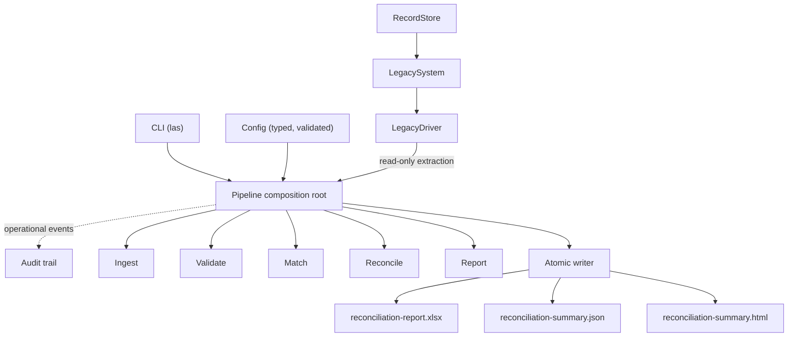

# Architecture

How the packages fit together, which way dependencies point, and why the
structure is shaped this way. It is written for someone reading the repository
for the first time.

## Scope and authoritative contracts

This document explains **structure and dependency direction**. It deliberately
does not restate behaviour that another document owns:

- **[PIPELINE_CONTRACT.md](PIPELINE_CONTRACT.md)** owns pipeline behaviour: the
  duties of each stage, the verification gate, artifact filenames, the directory
  transaction, audit events and payload keys, exit codes, and the terminal
  summary.
- **[REPORTING_CONTRACT.md](REPORTING_CONTRACT.md)** owns report structure:
  sheets, columns, fill colours, decimal rendering, the JSON schema, and the
  canonical workbook container.
- **[DEVELOPMENT_PLAN.md](DEVELOPMENT_PLAN.md)** owns history and reproducibility
  policy: the task ledger, the pinned fixture hashes, and the determinism rules
  the generator must obey.

Where this document mentions a stage or a filename, the contract is the
authority and this text is the map.

## Layer map

Two things the diagram is asserting, and one it is not.

It asserts that the simulator-facing path is **read-only**: the driver hands
extracted rows to the pipeline, and no arrow returns. Orchestration never writes
to `RecordStore` or `LegacySystem`. It also asserts that the writer produces the
artifact set — the three files are the output of one transaction, not three
independent writes.

It is **not** a statement about stages. The audit edge is dashed and labelled
operational precisely because audit is not one of the seven stages; the boxes
between `Pipeline` and `Writer` are packages, not stage names. Stage definitions
belong to the pipeline contract.

The dashed audit edge is also **conditional, not unconditional**. `run_pipeline`
takes an optional `trail`; events travel that edge only when a library caller
supplies one. The `las` commands supply none and configure no logging, so a CLI
run sends nothing along it and writes no audit or log file. Audit events never
enter a business result or a report artifact, which is why the edge stops at
`Audit` and never reaches `Writer`.

## The dependency rule

Dependencies point one way: **downward, toward the layer that owns the data**.

- `las.pipeline` may import every other package, because composing them is its
  only job.
- No other package imports `las.pipeline` or `las.cli`. Ingest, validation,
  matching, reconciliation and reporting are each usable, and testable, without
  any orchestration present.
- `las.simulator` imports nothing from the driver or any later layer. It
  produces faults; it never retries, recovers, or suppresses them.
- `las.driver` depends only on the standard library and the public simulator
  API.
- Cross-layer data travels as plain immutable value objects. Reconciliation, for
  instance, receives a neutral `SystemLedgerRow` and imports neither the driver
  nor the simulator, so a change to how rows are extracted cannot reach it.

This is a convention enforced by tests, not by a framework. There is no plugin
registry, no dependency-injection container and no abstract interface layer —
the packages are ordinary Python modules, and the discipline is that the import
graph stays acyclic and one-directional.

## How boundaries are enforced

Each layer has a `*_boundary.py` test module that reads its own package's source
and asserts what it may touch. These tests parse imports from the abstract
syntax tree rather than matching text, so a rename cannot quietly defeat them.
Between them they check that:

- no layer imports a package that depends on it;
- forbidden third-party modules are absent from layers that must not use them;
- importing a layer in a clean subprocess does not pull in a forbidden module;
- the simulator's source contains no retry, backoff or recovery vocabulary;
- readers open files only in explicit read modes, and nothing in ingest writes;
- no layer reads the wall clock, sleeps, or introduces randomness outside the
  one seeded injector that is allowed to.

Separate repository-policy and documentation-conformance suites check the same
kind of property at the repository level: that committed fixtures check out
byte-identically on every platform, and that these documents still agree with
the code.

## The simulated legacy system

`RecordStore` holds the synthetic records. `LegacySystem` wraps it in a
screen-shaped state machine — a search screen, a results table with a visible
window, a detail screen — so that reading data requires navigating, querying and
scrolling rather than calling a function.

On top of that sits a deterministic fault model with selectable profiles. Faults
are busy timeouts, transient error dialogs, stalled scroll positions and
occasional control failures. Every source of randomness lives behind a single
seeded injector, so a given seed reproduces a given sequence of faults exactly.

The simulator's job is to be difficult in reproducible ways. It has no notion of
retrying, and no code path that hides a fault it has decided to produce.

The selectable profiles are a **tested lower-level capability, not a CLI
feature**. The fault model, the injector and the profiles are public API and are
exercised heavily by the driver and simulator suites, but no `las` command
constructs a `FaultInjector`, so the CLI does not activate those optional
injected interaction faults. That is a statement about the simulator's
behaviour, not about the data: the synthetic feeds still carry every deliberate
validation, matching and reconciliation defect the generator puts there.
Reaching the profiles means driving `LegacySystem` directly.

`update_status` exists on the driver and is dry-run by default, but the pipeline
does not call it. Orchestration is read-only.

## The resilient driver

`LegacyDriver` turns that awkward surface into usable extraction. It:

- retries a **bounded** number of attempts, always a `for` loop over the
  configured maximum — never `while True`, never recursion;
- waits on an **injected clock**, so tests advance time instantly and nothing
  sleeps in the suite or in CI;
- recognises transient conditions and recovers the screen state deliberately;
- paginates the results table and proves when an extraction is complete, rather
  than assuming the widget's reported row count is truthful;
- raises typed errors carrying only safe scalar context — operation, attempt
  count, screen, timeout — and never an object representation.

## Data flow through one run

Seven public stages, in this order:

1. **extract** — build the store, system and driver from configuration; read the
   whole ledger through the public driver.
2. **ingest** — read master data and every configured feed, resolving header
   aliases to canonical field names.
3. **validate** — apply the rule engine; every row is preserved, none repaired
   or filtered.
4. **match** — resolve rows to accounts, exactly or fuzzily, with an explicit
   review outcome where confidence is insufficient.
5. **reconcile** — aggregate the feeds as one side against the system ledger as
   the other, grouped by account and period.
6. **report** — build one report model and render the configured formats in
   memory. No file is written.
7. **verify** — a final pure gate that re-reads the run's own invariants and
   refuses to publish a result that cannot describe itself truthfully.

Every stage before `verify` is pure: no directory is created and no byte is
written until the gate has passed. Only then does the atomic writer stage the
artifacts, verify them, and rename the directory into place. A run that fails
anywhere leaves the filesystem as it found it.

Stage duties are specified in [PIPELINE_CONTRACT.md](PIPELINE_CONTRACT.md).

## Determinism as a design constraint

Determinism here is a structural property, not a test that happens to pass:

- **Seeded fixtures.** The synthetic datasets derive entirely from one seed and
  regenerate byte-identically; their hashes are pinned in the development plan.
- **Stable identifiers.** A feed batch identifier is a hash of what the feed
  *is*, never of its position in a list or its order of arrival.
- **Explicit sorting.** Results are ordered by written-down sort keys, so
  mapping iteration order can never leak into output.
- **Immutable results.** Frozen dataclasses, tuples and read-only mappings mean
  a result cannot be mutated between production and rendering.
- **Injected time.** The clock is a dependency, and every pipeline run injects
  the simulated one, so a busy delay advances logical time instead of sleeping.
  Deterministic business execution — the stages, the simulated legacy
  interactions, reconciliation, report contents, and artifact names and
  ordering — calls no wall clock. The one exception is deliberately outside
  that contract: an optional audit trail, which only a library caller
  constructs and no `las` command does, stamps UTC wall-clock timestamps and
  mints a nondeterministic UUID run identifier. Those are operational values;
  they are not part of the three business report artifacts, and no artifact
  byte depends on them.
- **Canonical JSON and HTML.** Both are generated with fixed key order and fixed
  formatting, so repeated renders are byte-identical.
- **A canonical XLSX container.** The workbook's ZIP is rewritten with fixed
  entry timestamps and platform metadata, because the archive format otherwise
  records when the file was made.
- **Fixed workbook properties.** Document created and modified timestamps are
  pinned to a fixed epoch rather than the current time.
- **Atomic publication.** The output either exists complete or does not exist,
  so there is no intermediate state to observe.

Exact container fields and property values are in
[REPORTING_CONTRACT.md](REPORTING_CONTRACT.md).

## Failure design

- **Typed errors.** Each layer raises its own error type; nothing lets a
  lower-level exception escape unconverted.
- **Stable error codes.** Every error carries a code that does not change with
  its message, so the CLI can map it to an exit code and an operator can match
  on it.
- **Safe messages.** Error context is an allowlist of scalars. No path, cell
  value, account name or raw exception text is carried.
- **No traceback exposure.** A failing command prints one line to stderr and
  nothing to stdout.
- **Cleanup on every failure path.** The staging directory is removed whether
  the failure happened during writing, verification, or the final rename.
- **No partial output.** Because publication is a rename, a failed run leaves no
  output directory at all — and an existing directory is refused rather than
  merged into.
- **Audit records both outcomes — when it is enabled.** Given a caller-supplied
  trail, a successful run emits a completion event; a failed run emits exactly
  one failure event carrying the last active stage and the stable error code,
  and no completion event. Audit files are operational and may survive a failed
  run. With no trail — the CLI's case — nothing is recorded and no file exists.

## Trade-offs and rejected alternatives

**Explicit contracts over flexible implicit behaviour.** Writing the exact
column order, exit codes and audit keys into documents that tests enforce makes
the project rigid: a deliberate change means editing code, contract and tests
together. That rigidity is the point — it is what stops behaviour drifting
silently — but it would be the wrong choice for a codebase still exploring its
shape.

**Deterministic fixtures over random realism.** Property-based generation across
many seeds would explore more input space. A single pinned seed instead buys
exact assertions — this many duplicates, that many orphan references — and a
repository that reproduces byte for byte on any machine. The blind spot is
input the generator was never taught to produce.

**Report-only safety over end-to-end mutation.** Writing outcomes back would
make the demonstration more complete. It would also require inventing a mapping
from reconciliation outcome to record status that nothing in this project
justifies, so the write-back path stays implemented, tested, and unwired.

**Whole-directory publication over incremental updates.** Renaming a directory
is atomic and leaves no partial state, but it means a report set cannot be
amended in place — regenerating means publishing a new directory.

**Strict output conflict over overwrite convenience.** Refusing an existing
directory is occasionally annoying. The alternative is deciding, on the user's
behalf, that whatever is already there does not matter.

**Text diagrams over image assets.** Mermaid source reviews and diffs like code
and cannot drift out of date unnoticed. A drawn diagram would carry more nuance,
and would be stale within two tasks.
